<!--FRAMETOP:START-->

<picture>
  <source media="(prefers-color-scheme: dark)" srcset="art/frame-top-dark.svg">
  <source media="(prefers-color-scheme: light)" srcset="art/frame-top-light.svg">
  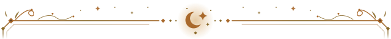
</picture>

<!--FRAMETOP:END-->

<!--BANNER:START-->

<picture>
  <source media="(prefers-color-scheme: dark)" srcset="art/banner-dark.svg">
  <source media="(prefers-color-scheme: light)" srcset="art/banner-light.svg">
  
</picture>

<!--BANNER:END-->

<picture>
  <source media="(prefers-color-scheme: dark)" srcset="https://readme-typing-svg.demolab.com?font=Cinzel&amp;weight=600&amp;size=22&amp;duration=3200&amp;pause=1400&amp;center=true&amp;vCenter=true&amp;width=760&amp;height=50&amp;repeat=true&amp;lines=Hi,+I%27m+Shamil;I+build+my+own+Windows+apps;Night+owl.+Gamer.+PC+builder;Learning+to+code,+for+real&amp;color=F3D79C">
  <source media="(prefers-color-scheme: light)" srcset="https://readme-typing-svg.demolab.com?font=Cinzel&amp;weight=600&amp;size=22&amp;duration=3200&amp;pause=1400&amp;center=true&amp;vCenter=true&amp;width=760&amp;height=50&amp;repeat=true&amp;lines=Hi,+I%27m+Shamil;I+build+my+own+Windows+apps;Night+owl.+Gamer.+PC+builder;Learning+to+code,+for+real&amp;color=8A5A12">
  
</picture>

## About me

I'm a student in the Netherlands who loves **gaming, building PCs and coding**. I'm still a beginner, but I build full apps together with Claude, and I'm learning to code properly along the way. I work best at night. **I push updates every couple of days.**

Everything I make shares one look I made up: **night and gold**, inspired by Genshin Impact. I write my READMEs in plain English on purpose.

Lees dit in het Nederlands

Ik ben een student in Nederland die gek is op **gamen, pc's bouwen en programmeren**. Ik ben nog beginner, maar ik bouw complete apps samen met Claude en leer ondertussen echt programmeren. Ik werk het best 's nachts.

Alles wat ik maak heeft dezelfde stijl die ik zelf bedacht heb: **nacht en goud**, geïnspireerd door Genshin Impact. Ik schrijf mijn README's bewust in gewone, eenvoudige taal.

**Ik zet elke twee dagen of zo nieuwe updates online.**


<!--DIVIDER-->

<picture>
  <source media="(prefers-color-scheme: dark)" srcset="art/frame-divider-dark.svg">
  <source media="(prefers-color-scheme: light)" srcset="art/frame-divider-light.svg">
  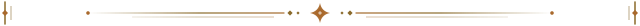
</picture>

## My Windows, but mine

Windows comes with good apps. I'm replacing the ones I use every day with my own, one at a time: File Explorer with **Waypoint**, Task Manager with **Leyline**, Photos with **Tsukimi** and Notepad with **Haravatat**.

<picture>
  <source media="(prefers-color-scheme: dark)" srcset="art/strip-dark.svg">
  <source media="(prefers-color-scheme: light)" srcset="art/strip-light.svg">
  
</picture>

<!--DIVIDER-->

<picture>
  <source media="(prefers-color-scheme: dark)" srcset="art/frame-divider-dark.svg">
  <source media="(prefers-color-scheme: light)" srcset="art/frame-divider-light.svg">
  
</picture>

## Now building

<!--NOW:START-->

<table>
  <tr>
    <td width="80" align="center">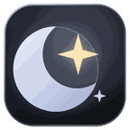</td>
    <td><b>Tsukimi</b>, my own photo viewer, in a calm <i>Moonlight</i> look. Open a photo, zoom, flick to the next one, and nothing else gets in the way. It is the app I already use instead of Windows Photos. <i>Not public yet.</i></td>
  </tr>
  <tr>
    <td width="80" align="center"></td>
    <td><b>Haravatat</b>, my own native notepad, in a <i>Sumeru scholar</i> look: deep green night, gold, and a leaf of lime. A quick, tidy replacement for Windows Notepad. <i>Not public yet.</i></td>
  </tr>
</table>

<!--NOW:END-->

<!--DIVIDER-->

<picture>
  <source media="(prefers-color-scheme: dark)" srcset="art/frame-divider-dark.svg">
  <source media="(prefers-color-scheme: light)" srcset="art/frame-divider-light.svg">
  
</picture>

## This week's spotlight

One of my apps gets the stage each week. It changes by itself.

<!--SPOTLIGHT:START-->

<a href="https://github.com/Shamilimanuel/Courier"></a>

<!--SPOTLIGHT:END-->

<!--DIVIDER-->

<picture>
  <source media="(prefers-color-scheme: dark)" srcset="art/frame-divider-dark.svg">
  <source media="(prefers-color-scheme: light)" srcset="art/frame-divider-light.svg">
  
</picture>

## My apps, as a party

My apps are a night sky. Each star has the colour of its element, and the five-star apps shine biggest.

<picture>
  <source media="(prefers-color-scheme: dark)" srcset="art/constellation-dark.svg">
  <source media="(prefers-color-scheme: light)" srcset="art/constellation-light.svg">
  
</picture>

<!--LINKS:START-->

Waypoint &middot; Leyline &middot; <a href="https://github.com/Shamilimanuel/Toolbelt">Toolbelt</a> &middot; <a href="https://github.com/Shamilimanuel/Reveille">Reveille</a> &middot; <a href="https://github.com/Shamilimanuel/Akasha-Terminal">Akasha Terminal</a> &middot; <a href="https://github.com/Shamilimanuel/Courier">Courier</a> &middot; Housecall &middot; <a href="https://github.com/Shamilimanuel/Launcher">Seelie</a>

Waypoint, Leyline and Housecall are private for now.

<!--LINKS:END-->

They are also character cards. The **element** says what kind of app it is, and the **stars** say how far along it is (5 = finished and used every day, 4 = works and still growing). Click a card to open the project. A card with a small "private for now" mark has no link yet.

<!--CARDS:START-->

<a href="https://github.com/Shamilimanuel/Toolbelt"></a>
<a href="https://github.com/Shamilimanuel/Reveille"></a>
<a href="https://github.com/Shamilimanuel/Akasha-Terminal"></a>
<a href="https://github.com/Shamilimanuel/Courier"></a>
<a href="https://github.com/Shamilimanuel/Launcher"></a>

<!--CARDS:END-->

Screenshots (made-up example data)

| | |
| --- | --- |
| 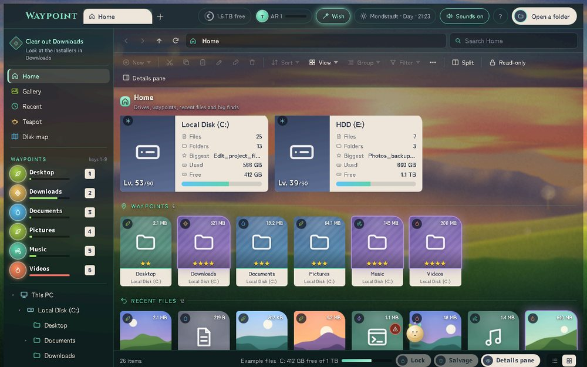 **Waypoint** *(private for now)*: a file manager where drives are levels and folders are waypoints. | 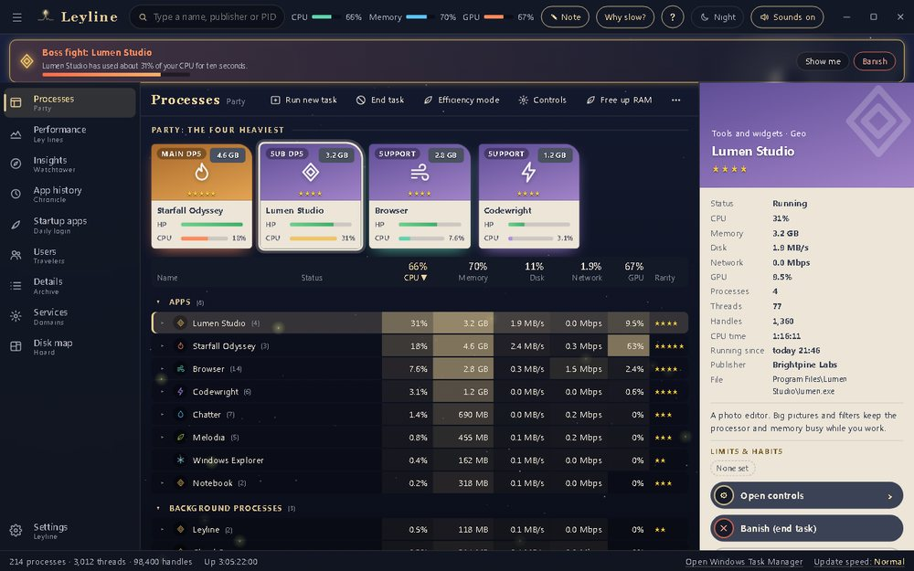 **Leyline** *(private for now)*: a task manager that shows your programs as a party. |
| [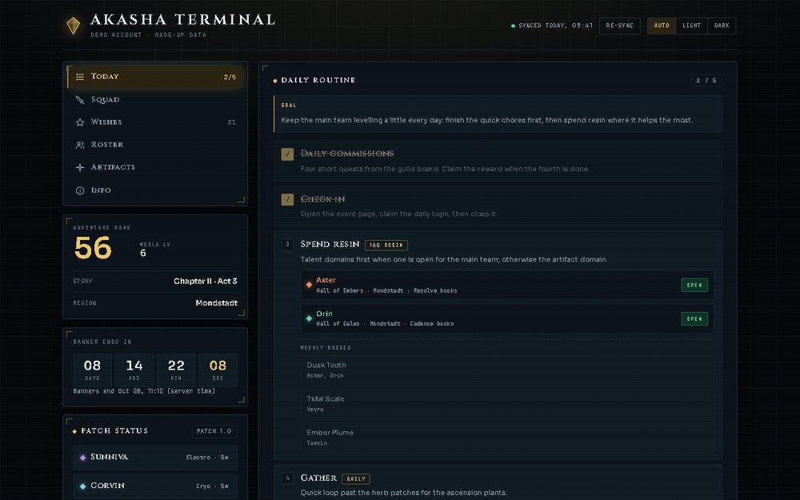](https://github.com/Shamilimanuel/Akasha-Terminal) **[Akasha Terminal](https://github.com/Shamilimanuel/Akasha-Terminal)**: a calm dashboard for a Genshin account. | [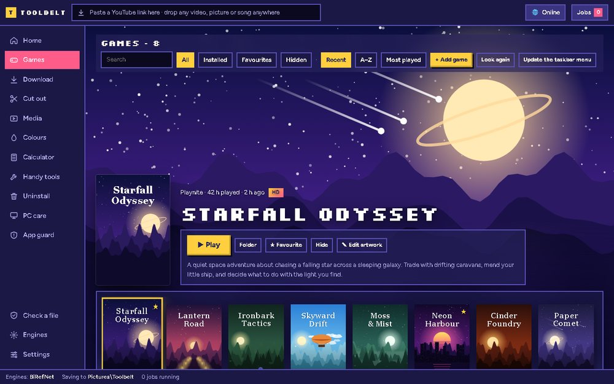](https://github.com/Shamilimanuel/Toolbelt) **[Toolbelt](https://github.com/Shamilimanuel/Toolbelt)**: one Windows app for everyday jobs that usually need a website. |

*All pictures use made-up example data: invented files, programs, games and a made-up player.*

<!--DIVIDER-->

<picture>
  <source media="(prefers-color-scheme: dark)" srcset="art/frame-divider-dark.svg">
  <source media="(prefers-color-scheme: light)" srcset="art/frame-divider-light.svg">
  
</picture>

## My stack, and what I'm levelling up

<picture>
  <source media="(prefers-color-scheme: dark)" srcset="https://skillicons.dev/icons?i=python,js,ts,html,css,kotlin,cs,powershell,git,github,vscode,androidstudio&amp;perline=12&amp;theme=dark">
  <source media="(prefers-color-scheme: light)" srcset="https://skillicons.dev/icons?i=python,js,ts,html,css,kotlin,cs,powershell,git,github,vscode,androidstudio&amp;perline=12&amp;theme=light">
  
</picture>

<!--LEVEL:START-->

<picture>
  <source media="(prefers-color-scheme: dark)" srcset="art/levelling-dark.svg">
  <source media="(prefers-color-scheme: light)" srcset="art/levelling-light.svg">
  
</picture>

<!--LEVEL:END-->

<!--DIVIDER-->

<picture>
  <source media="(prefers-color-scheme: dark)" srcset="art/frame-divider-dark.svg">
  <source media="(prefers-color-scheme: light)" srcset="art/frame-divider-light.svg">
  
</picture>

## GitHub stats

<picture>
  <source media="(prefers-color-scheme: dark)" srcset="https://github-readme-stats-eight-theta.vercel.app/api?username=Shamilimanuel&amp;show_icons=true&amp;hide_border=true&amp;bg_color=0D1220&amp;title_color=F3D79C&amp;text_color=ECE5D8&amp;icon_color=D3BC8E&amp;ring_color=D3BC8E">
  <source media="(prefers-color-scheme: light)" srcset="https://github-readme-stats-eight-theta.vercel.app/api?username=Shamilimanuel&amp;show_icons=true&amp;hide_border=true&amp;bg_color=F6F1E7&amp;title_color=8A5A12&amp;text_color=2B3142&amp;icon_color=A9692C&amp;ring_color=A9692C">
  
</picture>
<picture>
  <source media="(prefers-color-scheme: dark)" srcset="https://github-readme-stats-eight-theta.vercel.app/api/top-langs/?username=Shamilimanuel&amp;layout=compact&amp;langs_count=6&amp;hide_border=true&amp;bg_color=0D1220&amp;title_color=F3D79C&amp;text_color=ECE5D8&amp;icon_color=D3BC8E&amp;ring_color=D3BC8E">
  <source media="(prefers-color-scheme: light)" srcset="https://github-readme-stats-eight-theta.vercel.app/api/top-langs/?username=Shamilimanuel&amp;layout=compact&amp;langs_count=6&amp;hide_border=true&amp;bg_color=F6F1E7&amp;title_color=8A5A12&amp;text_color=2B3142&amp;icon_color=A9692C&amp;ring_color=A9692C">
  
</picture>

<!--ACTIVITY:START-->

<picture>
  <source media="(prefers-color-scheme: dark)" srcset="art/activity-dark.svg">
  <source media="(prefers-color-scheme: light)" srcset="art/activity-light.svg">
  
</picture>

<!--ACTIVITY:END-->

<!--DIVIDER-->

<picture>
  <source media="(prefers-color-scheme: dark)" srcset="art/frame-divider-dark.svg">
  <source media="(prefers-color-scheme: light)" srcset="art/frame-divider-light.svg">
  
</picture>

## Note of the day

<!--NOTE:START-->

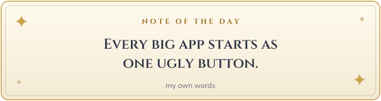

<!--NOTE:END-->

Recently updated

<!--RECENT:START-->

| Project | What it is | Last updated |
| --- | --- | --- |
| [Seelie](https://github.com/Shamilimanuel/Launcher) | Seelie: an Android home-screen launcher with live wallpapers, an A-Z app list, a night... | 5 days ago |
| [Terminal](https://github.com/Shamilimanuel/Terminal) | A custom look for Windows Terminal and PowerShell | 7 days ago |
| [Akasha-Terminal](https://github.com/Shamilimanuel/Akasha-Terminal) | A night-and-gold dashboard for a Genshin Impact account | 7 days ago |
| [Irminsul](https://github.com/Shamilimanuel/Irminsul) | A night-blue, cream and gold theme for VS Code, with the seven elements as the colours... | 7 days ago |
| [Custom-Clock](https://github.com/Shamilimanuel/Custom-Clock) | A two-line Windows 11 taskbar clock | 7 days ago |

<!--RECENT:END-->

*Rebuilt from GitHub by itself, every day.*

A few quick facts

- I do my best work at **night**.
- I **build PCs** for fun.
- I replace Windows apps with **my own**, one at a time.
- I'm **learning to code**, with Claude.
- Every app of mine has an **element** (see the constellation above).

<!--PROJECTS:START-->

All my projects (10 public, 5 private for now)

### Apps (Windows)

| Project | What it is |
| --- | --- |
| Waypoint *(private for now)* | A Genshin-inspired file manager: drives are "levels", folders are waypoints, and the Recycle Bin is called Salvage. Has a disk map and live backgrounds. |
| Leyline *(private for now)* | A task manager where your programs are a party and the heavy ones get a "boss fight" banner. Also a game overlay and a disk map. |
| [Toolbelt](https://github.com/Shamilimanuel/Toolbelt) | One app for the everyday things I would otherwise need a dozen websites for. Everything runs on your own PC. |
| Housecall *(private for now)* | Finds and fixes computer problems. It only looks until you say yes, and nothing is installed. |
| [Courier](https://github.com/Shamilimanuel/Courier) | Send text, clipboard and files between your own devices over your own Wi-Fi: no cloud, no account. PC, desktop and Android apps. |
| [Reveille](https://github.com/Shamilimanuel/Reveille) | Start, shut down, restart, sleep and lock your computer from your phone, over home Wi-Fi. |

### Widgets (small Windows helpers)

| Project | What it is |
| --- | --- |
| [Terminal](https://github.com/Shamilimanuel/Terminal) | A custom look for Windows Terminal and PowerShell: a see-through theme, a welcome screen, live PC status and short commands. |
| [Clipboard](https://github.com/Shamilimanuel/Clipboard) | A clipboard history: copy as usual, press a hotkey, pick any earlier clip. |
| [Snipper](https://github.com/Shamilimanuel/Snipper) | A snipping tool with a text reader built in: drag a box, mark it up, or copy the words out of a picture. |
| [Custom Clock](https://github.com/Shamilimanuel/Custom-Clock) | A two-line clock for the Windows 11 taskbar: date and time on top, CPU, GPU, RAM or media below. |
| Crosshairs *(private for now)* | A see-through, click-through crosshair overlay for your games, with a separate save for each game. |

### Android

| Project | What it is |
| --- | --- |
| [Launcher (Seelie)](https://github.com/Shamilimanuel/Launcher) | An Android home-screen launcher with live wallpapers, an A-Z app list, a night screen and a PIN vault. Written in Kotlin. |

Reveille and Courier have Android apps too (see above).

### Web, study and code editor

| Project | What it is |
| --- | --- |
| Leerlantaarn (was Leeromgeving) *(private for now)* | A study site for Dutch VMBO students: summaries, flashcards with spaced repetition and a practice game. The app is in Dutch. |
| [Akasha Terminal](https://github.com/Shamilimanuel/Akasha-Terminal) | A night-and-gold dashboard for a Genshin Impact account: daily routine, wish counter, roster and an artifact lab. |
| [Irminsul](https://github.com/Shamilimanuel/Irminsul) | A night-blue, cream and gold theme for VS Code, with the seven elements as colours. |

<!--PROJECTS:END-->

<!--DIVIDER-->

<picture>
  <source media="(prefers-color-scheme: dark)" srcset="art/frame-divider-dark.svg">
  <source media="(prefers-color-scheme: light)" srcset="art/frame-divider-light.svg">
  
</picture>

## Contact

My portfolio, with pictures of everything: **[shamilimanuel.github.io](https://shamilimanuel.github.io/)**

---

*The Genshin-style projects are unofficial, fan-made and not affiliated with or endorsed by HoYoverse. The character cards above are my own drawings in the style of the game, with my own app icons: no game assets.*

<!--FRAMEBOTTOM:START-->

<picture>
  <source media="(prefers-color-scheme: dark)" srcset="art/frame-bottom-dark.svg">
  <source media="(prefers-color-scheme: light)" srcset="art/frame-bottom-light.svg">
  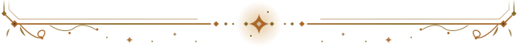
</picture>

<!--FRAMEBOTTOM:END-->
